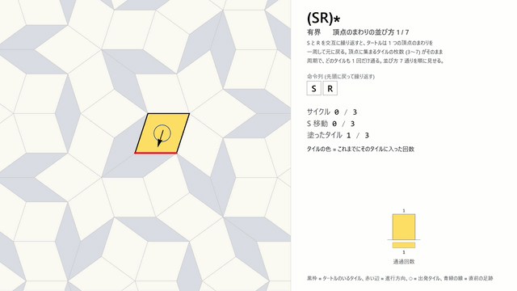
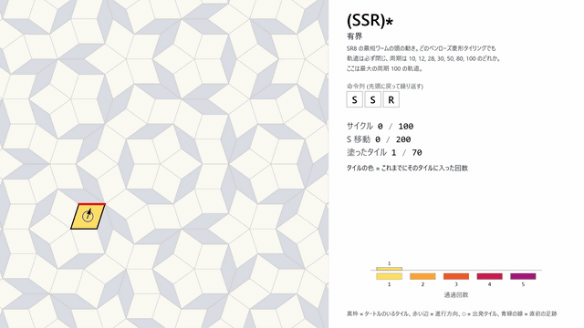
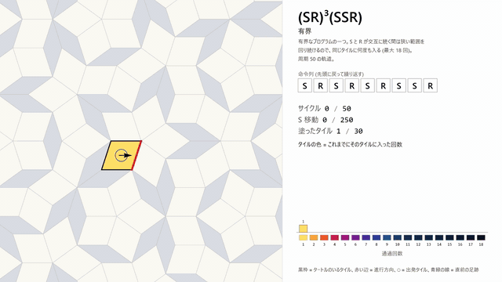
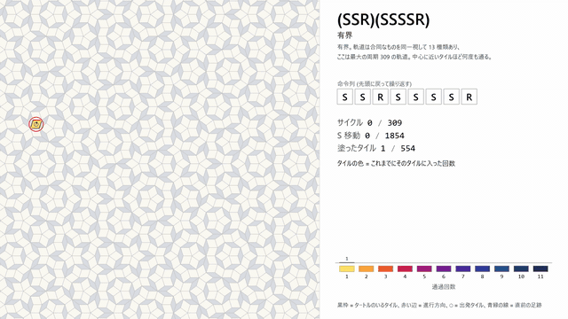
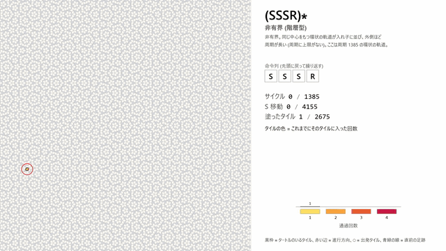
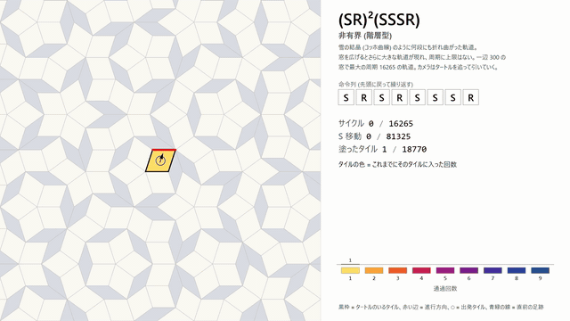
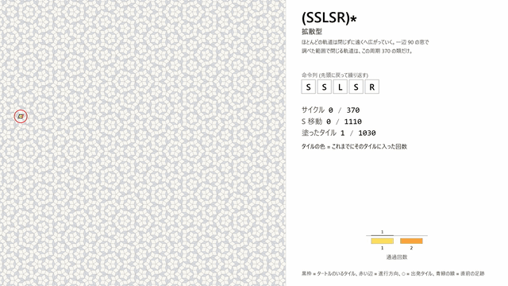
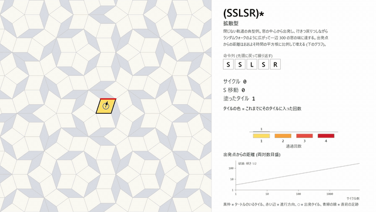

# pt_turtle — turtle walks on Penrose rhomb tilings

Computer-assisted proofs, machine-checkable certificates and exhaustive surveys for the
boundedness of *turtle* walks on Penrose rhomb tilings.  This repository is the supplementary
material of the paper

> Katsunobu Imai, *Boundedness of turtle orbits on Penrose rhomb tilings* (prepared for ASCAT 2027).

The paper itself is not included before publication; the proofs are given here in
`proof_sketch.md` and `proof_unbounded.md`.  The question comes from the
reversible self-reproducing cellular automaton SR8 (Morita and Imai, 1996) carried over to Penrose
tilings in the preceding paper *Signal propagation and reversibility on Penrose tiling* (in:
Understanding Reversibility, World Scientific, to appear): the head of an SR8 worm moves like a
turtle, and the shortest worm follows the program (SSR)*.

## Turtles

A state is a pair (tile, edge) of a Penrose rhomb tiling; the edge is the heading.  The commands are
`S` (cross the heading edge into the neighbouring rhomb and take the opposite edge as the new heading,
which continues straight along a de Bruijn ribbon), `R` and `L` (rotate the heading clockwise /
counter-clockwise inside the tile).  A program P is applied cyclically, written (P)*.  Since S, R
and L are bijections of the set of states, every orbit is either periodic or infinite; a program is
*bounded* if every orbit on every Penrose rhomb tiling is periodic.

## Main results

* **(SSR)\* is bounded on every Penrose rhomb tiling.**  The periods are exactly
  {10, 12, 28, 30, 50, 80, 100} and the swept sets fall into 7 congruence classes.  Hence the
  shortest SR8 worm never collides with itself wherever it is placed on a Penrose tiling (its
  periods are 8 times the turtle periods).
* **59 programs are bounded** (52 up to mirror, rotation and powers), e.g. (SSR)(SSSSR),
  (SR)^3(SSR), (SSR)(SR)^3(SSR), and the single-exit family (SR)^{k-3}(SSR) for
  k = 3, 6, 9, 10, 12, 15, 18, 20, 21, 22, 24, 27, 29, 30, 35, 40, 45, 50.
  Method: exact Robinson-triangle substitution σ in Z[ζ], an atlas of 30 marked-triangle coronas
  that is closed under σ (hence complete, by repetitivity), and exhaustive verification of all
  orbits starting in the central supertriangle of the patches σ^n(corona), n = 7 … 10, none of
  which attempts to leave its patch.  The verification was repeated with three independent
  implementations (the Python code here, `wl_verify.wl` on top of the author's `TurtleTiling.wl`,
  and the Wolfram Language code in `notebook_src/`).
* **(SSSR)\* is not bounded.**  In every Penrose rhomb tiling and for every odd m ≥ 7, every
  positively oriented obtuse level-m supertriangle carries an orbit segment of
  N_m = 7·2^(m−2) − 22 S-moves (202, 874, 3562, …) with pairwise distinct states; so periods are
  unbounded in every tiling, and by compactness some Penrose tiling has an infinite orbit.  The
  proof is an induction on the substitution level over a finite *pass-substitution system*
  (60 pass families and 120 port families obeying the exact affine law a_{m+2} = φ² a_m + δ),
  given as a certificate and accepted by two independently written checkers.  The same method
  proves 18 programs unbounded, e.g. (SLSR)*, (SR)(SSR), (SR)^2(SSR), (SSSSSR)*.
* **Three regimes.**  On windows of side 46 / 160 / 300 (pentagrid coordinates) of the pentagrid
  tiling with offsets (0, 0.1, −0.1, 0.2, −0.2), the 43 programs of length ≤ 8 without adjacent
  turns split into uniformly bounded (7), hierarchical (30; orbit sizes grow with the window) and
  diffusive (6; e.g. (SSLSR)*, almost all orbits escape, displacement ~ t^0.4 … t^0.5).

## Examples: animations of turtle orbits

`notebook_src/anim/` contains eight animations (MP4, 1920×1080, 30 fps, 17–35 s) made by
`notebook_src/anim_orbits.wl`.  The turtle (black outline: its rhomb, red edge: its heading) paints every rhomb
it enters, and the colour of a rhomb is the number of times it has been entered so far: 1 yellow, 2 orange,
3 red-orange, 4 crimson, 5 magenta, 6 purple, 7 violet, 8 indigo, and darker blues for more.  The panel on the
right (in Japanese) shows the program with the current command, the numbers of cycles, S moves and painted
rhombs, and the histogram of the rhombs by number of visits.  The first cycles run one command at a time, then
the turtle speeds up; a periodic orbit is followed until the turtle is back in its initial state.  The pictures
below are GIF previews (time-lapses of 6–8 s, 640 px wide); click one to open the MP4, which GitHub offers for
download ("View raw").  The last frame of every video is `notebook_src/anim/turtle-<name>-final.png`.

All eight animations use one Penrose rhomb tiling, the pentagrid tiling with offsets (0, 0.1, −0.1, 0.2, −0.2)
of the surveys.  The windows of side 90 and 300 are cut from it at the same corner (−3, −3), so the window of
side 90 is a part of the window of side 300 (all its 62 551 rhombs coincide).  The six animations on the window
of side 90 show orbits near its centre, the two on the window of side 300 orbits near the centre of that window
(`notebook_src/anim/parameters.txt`, in Japanese).

| animation (click to play) | program and orbit |
|---|---|
| <a href="notebook_src/anim/turtle-sr.mp4"></a> | **(SR)\*** — bounded.  The simplest program: the turtle goes once around a vertex and is back after as many cycles as there are rhombs at the vertex (3 to 7); every rhomb is entered once.  One orbit for each of the seven vertex stars (up to congruence), in turn. |
| <a href="notebook_src/anim/turtle-ssr.mp4"></a> | **(SSR)\*** — bounded; the head of the shortest SR8 worm.  The orbit of period 100, the largest of the periods {10, 12, 28, 30, 50, 80, 100}: 70 rhombs, each entered 1, 3, 4 or 5 times. |
| <a href="notebook_src/anim/turtle-sr3ssr.mp4"></a> | **(SR)^3(SSR)** — bounded.  Period 50, 30 rhombs.  While S and R alternate, the turtle stays in a small region, so the rhombs are entered 2, 8, 10 or 18 times. |
| <a href="notebook_src/anim/turtle-ssr-ssssr.mp4"></a> | **(SSR)(SSSSR)** — bounded.  The largest of its 13 orbit classes: period 309, 554 rhombs, each entered 1 to 11 times; the rhombs near the centre are entered most often. |
| <a href="notebook_src/anim/turtle-sssr.mp4"></a> | **(SSSR)\*** — unbounded, hierarchical.  Period 1385, 2675 rhombs, each entered 1, 2 or 4 times: a ring with fivefold symmetry.  Larger windows contain orbits of larger periods (the periods are unbounded, see Main results). |
| <a href="notebook_src/anim/turtle-sr2sssr.mp4"></a> | **(SR)^2(SSSR)** — unbounded, hierarchical.  Period 16 265, the largest on the window of side 300; 18 770 rhombs, each entered 1 to 9 times.  A snowflake-like (Koch-curve-like) orbit; the camera zooms out with the turtle.  The whole outline is drawn in the first half of the period, and the second half runs along it again, adding rhombs and visits. |
| <a href="notebook_src/anim/turtle-sslsr.mp4"></a> | **(SSLSR)\*** — diffusive, a rare closed orbit.  Period 370, 1030 rhombs, each entered once or twice; the only class of closed orbits on the window of side 90 (almost all orbits of this program escape). |
| <a href="notebook_src/anim/turtle-sslsr-walk.mp4"></a> | **(SSLSR)\*** — diffusive, a typical orbit.  Of the four headings of the rhomb at the centre of the window of side 300, the one that reaches the border last: the turtle wanders like a random walk and reaches the border after 8925 cycles (23 388 rhombs, each entered 1 to 4 times); the camera zooms out with the turtle.  The panel adds a log-log plot of the distance from the start, which grows roughly like the square root of the time (dashed line: slope 1/2). |

## Layout

| path | content |
|---|---|
| `proof_sketch.md` | the boundedness argument for (SSR)* (English) |
| `proof_unbounded.md` | statement, proof and certificate format of the unboundedness of (SSSR)* (English) |
| `pt.py` | pentagrid tiling (de Bruijn), edge adjacency, vectorised turtle, orbit classification |
| `subst.py`, `subst_fast.py` | exact Robinson-triangle substitution in Z[ζ], coronas, canonical forms |
| `prove2.py`, `prove_many.py` | boundedness pipeline: atlas, closure check, verification V(P, n), certificates |
| `export_patches.py`, `wl_verify.wl` | export of the verification patches and an independent Wolfram Language check (needs the author's `CellularAutomata.wl` / `TurtleTiling.wl`, not included) |
| `turtle_survey.cu`, `build.bat`, `survey.py`, `survey_all.py`, `survey_exits.py`, `survey_ronly.py`, `survey_ronly2.py`, `progs.py` | CUDA survey kernel and drivers of the window surveys |
| `test_pivot.py`, `diffusion.py`, `figs.py`, `fig_pass.py`, `tables.py` | pivot-walk check, diffusion exponent, figures (`figs/`), tables |
| `lsys.py`, `extract2.py`, `batch_unbounded.py`, `collect_certs.py` | extraction of the pass-substitution certificates |
| `verify_cert.py`, `indep_check.py` | the two independent certificate checkers |
| `results/` | boundedness certificates (`proof2_*.json`, `proof_many.json`), survey outputs (`surveyall_*.json`, `surveyexits_300.json`, `surveyronly*.json`), unboundedness certificates (`unbounded_certs/`) |
| `logs/`, `figs/` | logs of the runs and figures produced by the Python scripts |
| `notebook_src/` | Wolfram Language code of a third, self-contained implementation (exact substitution, atlas, verification, exact congruence classes, window surveys) and the figure scripts of the paper; see `notebook_src/README.md` |
| `notebook_src/anim/` | the animations of the Examples section (MP4, GIF preview and the last frame as PNG), made by `notebook_src/anim_orbits.wl` |

## Reproduce

```
python prove2.py SSR 7 8                 # (SSR)*: atlas, closure and verification at level 7 (about 2 min)
python prove2.py SSRSSSSR 9 8 --cuda     # (SSR)(SSSSR) at level 9 on the GPU
python prove_many.py --auto              # all bounded programs of results/proof_many.json
python survey.py gen 300                 # window of side 300, then e.g.
python survey.py run 300 SSSR            # survey of (SSSR)* (GPU kernel built with build.bat)
python verify_cert.py results/unbounded_certs/cert2_SSSR_1p_1.json     # checker 1
python indep_check.py results/unbounded_certs/cert2_SSSR_1p_1.json     # checker 2
python export_patches.py SSR 7           # writes results/patches_SSR_n7.json for wl_verify.wl
wolframscript -file wl_verify.wl results/patches_SSR_n7.json
```

Python 3.14 with numpy 2.4 (matplotlib for the figures); CUDA 12.9 and MSVC for `turtle_survey.cu`;
Wolfram 15.0 for `notebook_src/` and `wl_verify.wl`.

## Notes

* The orbit-class counts written by the GPU survey (`results/surveyall_*.json`, `surveyexits_300.json`,
  `surveyronly*.json`) come from a float32 signature and are too large for programs with large orbits
  (e.g. (SSRSSSSR)*: 38 instead of 13; (SSSR)* on the window of side 300: 63 instead of 41).  The paper
  uses exact congruence classes computed in `notebook_src/` (`survey_exact.wl`); the counts of closed
  and escaped orbits agree exactly.
* `results/patches_SSR_n7.json` (24 MB, the input of `wl_verify.wl`) is not included; `export_patches.py`
  regenerates it.

## Citation

Please cite the ASCAT 2027 paper, and the preceding paper for SR8 on Penrose tilings:
Katsunobu Imai, *Signal propagation and reversibility on Penrose tiling*, in: Understanding
Reversibility, World Scientific (to appear).

## Revision of 2026-10-07 (tag `ascat2027`)

Changes made after a critical review of the ASCAT 2027 manuscript:

* `PROGRAMS.md` — complete lists of the programs of the theorems: the 59 bounded programs (with the
  verification level, the number of initial states, the period spectrum, the number of swept-set classes
  and the agreement of the two implementations), the 15 further bounded programs, and the 21
  unboundedness certificates with their root pass family, lengths, exact recurrence and checker results.
* `notebook_src/verify_orbit_classes.wl` — exact classification of the closed orbits of a program on the
  verification patches as *cyclic sequences of states* (rhomb vertices and heading edge in Z[zeta]) up to
  translations and rotations by multiples of 36 degrees, i.e. the orientation-preserving part of G.
  For (SSR)* at level 7 this gives 7 orbits, one for each period, so the 7 swept-set classes of the paper
  are also 7 dynamical orbit classes (log in `notebook_src/data/orbit_classes_SSR_n7.log`).
* `notebook_src/lib.wl`, `verify_classes.wl` — congruence classes are identified by comparing the exact
  canonical forms themselves; the earlier version compared hash values of the canonical forms.
* `notebook_src/review_data.wl` — the numbers quoted in the survey section: initial states per window
  (tiles whose four neighbours lie in the window: 15 902 / 195 801 / 690 036 tiles, i.e. 63 608 / 783 204 /
  2 760 144 states for the windows 46 / 160 / 300) and the distance from the centre of each of the 30 coronas
  to the boundary of the corona (minimum sin 36 degrees, up to rounding).
* Exactness: all coincidences of points and all congruence tests are integer computations in Z[zeta].
  The only floating-point quantities in the proofs are the distance margins of obligation O5 / (V3) of the
  pass-substitution certificates, whose minimum margin (1.89 for (SSSR)*) exceeds the rounding error of the
  double-precision evaluation (below 1e-9) by many orders of magnitude.
* The survey of the "43 programs" enumerates the programs of length at most 8 that contain `S` and at least
  one turn, with no two turns cyclically adjacent, up to cyclic shifts and mirroring (powers are not
  identified); `progs.py`.

## Revision of 2026-10-07, second round (tag `ascat2027` moved to this commit)

* `verify_cert_exact.py` — exact re-verification of the exit property (obligation O5 / condition (V3)) of a
  certificate without floating-point arithmetic: squared distances, dot products and segment parameters are
  computed in Q(sqrt 5), the square roots of the margin condition are enclosed by rational interval bounds.
  All 22 certificates pass; the rigorous lower bound of the smallest margin surplus is 1.887 for (SSSR)*
  (0.675 over all certificates).  `verify_cert.py`'s floating-point check remains as a first filter.
* `collect_cert_roots.py` → `results/unbounded_certs/certs_roots.json` — one record per certificate file with the
  designated root pass families (id, type, lowest level, lengths, exact recurrence) and the results of
  `verify_cert.py`, `indep_check.py` and `verify_cert_exact.py`.  `PROGRAMS.md` is now generated from these records,
  so every row of its table C refers to exactly one certificate file (the earlier version had attached the root of
  `cert_SSSR.json` to the file name `cert2_SSSR_1p_1.json`).
* `notebook_src/corona_margin_exact.wl` — the distance from the centre triangle to the boundary of each of the 30
  coronas, in exact algebraic arithmetic: it equals sin 36 degrees for every corona.  The proof of Theorem 1 only uses
  that this minimum is positive.
* `PROGRAMS.md` — the "WL check" column of table A now reports the agreement recorded by `verify_all.wl`, which
  compares the number of initial states, the absence of escapes and time-outs and the period spectrum; the names in
  table B no longer carry the internal "@level" suffix.
* `notebook_src/verify_classes.wl force` recomputes all class data, ignoring the cached `verify_classes.wxf`
  (the cache distributed with the tag was regenerated with the hash-free comparison; see `data/verify_classes_force.log`).

## Revision of 2026-10-07, third round (tag `ascat2027` moved to this commit)

* `collect_cert_roots.py` — the constant term of the recurrence is printed by `verify_cert.py` as `+ 66` or `+ -6`;
  the collector read only unsigned numbers after the sign, so the two certificates with a negative constant
  (`cert_SLSR.json`, `cert_SLSRSLSR.json`, recurrence N(m+2) = 4 N(m) - 6) had no root families in
  `certs_roots.json` and were missing from table C of `PROGRAMS.md`.  The collector now reads signed constants,
  only reads `cert_*.json` and `cert2_*.json` (its own output `certs_roots.json` was matched by the earlier pattern),
  checks the structure of every input and the exit code of every checker, and stops if the root families reported by
  `verify_cert.py` are not exactly the roots designated in the certificate.
* `PROGRAMS.md` regenerated: table C has 22 rows (one per designated root of the 22 certificate files; 20 programs up
  to cyclic shifts and mirroring, 18 up to powers, as in the paper), and table A has the number of classes for all
  59 bounded programs.  The previous table had been generated while `verify_classes.wl force` was still running, so 25
  entries of the class column were "-"; `programs_md.wl` now stops with an error when class data or a `verify_all.wl`
  record is missing, when a certificate file has no root family, or when the records do not cover the certificate files.
* `notebook_src/programs_md.wl` and `notebook_src/verify_classes.wl` (with the `force` option) are the versions that
  produced `PROGRAMS.md` and `data/verify_classes_force.log`; the previous commit had updated the outputs but not these
  two sources.
* `notebook_src/corona_margin_exact.wl` — the signs and the minimum are now decided without any numerical
  approximation: every compared quantity is written as a + b sqrt 5 with rational a, b (the script stops if a quantity
  is not of this form) and its sign is decided by rational arithmetic.  For each of the 30 coronas the script checks
  that every candidate squared distance is >= (5 - sqrt 5)/8 and that one of them is equal to it
  (`data/corona_margin_exact.log`).
